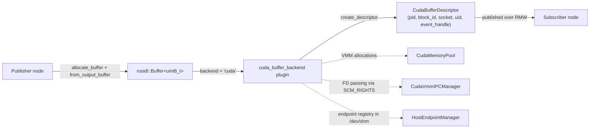
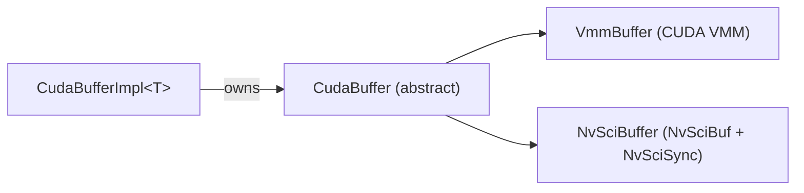
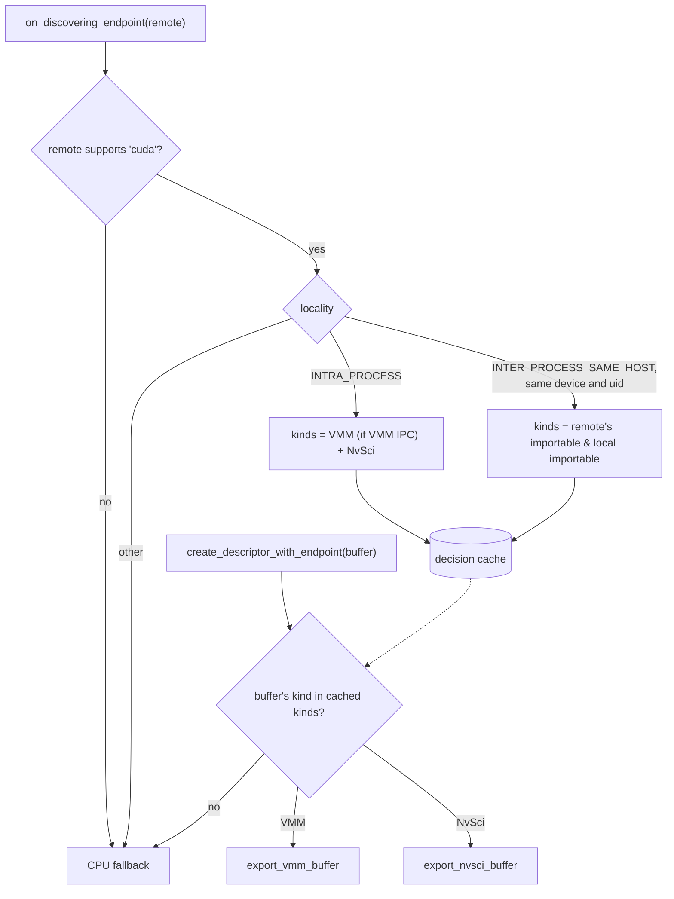
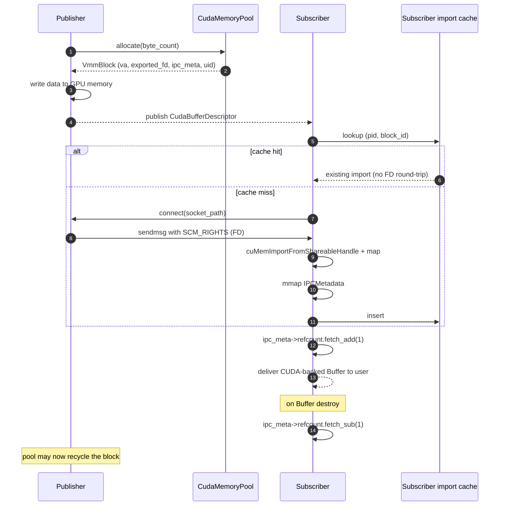
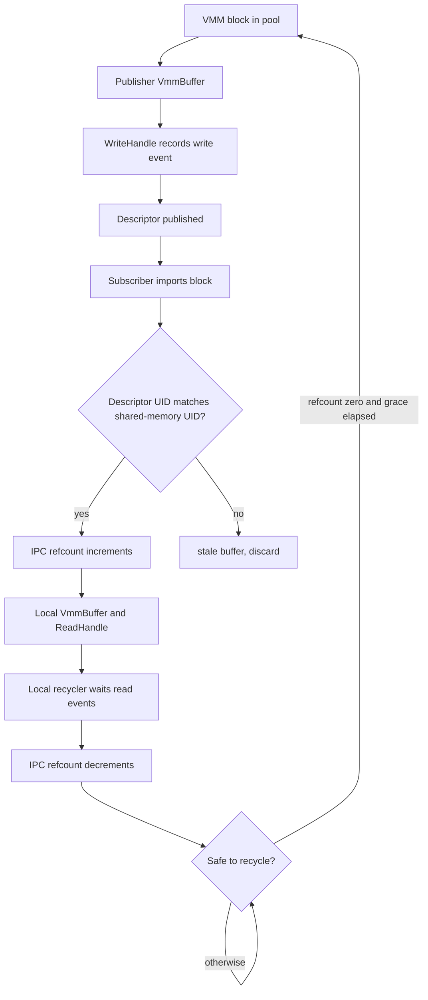
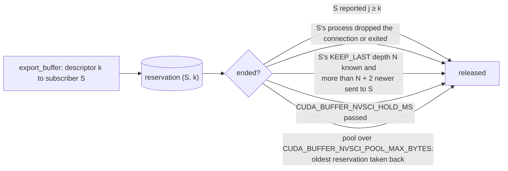
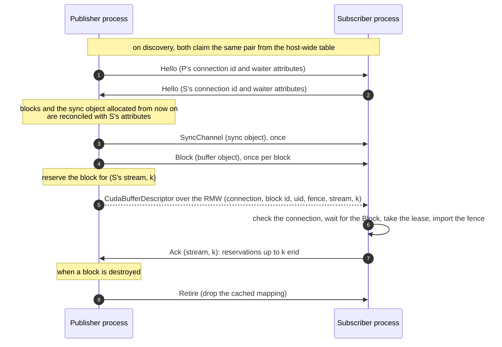

# Design

## Introduction

`cuda_buffer_backend` is a `rosidl::Buffer<T>` storage backend that allocates
the message payload in CUDA Virtual Memory (VMM) and delivers it to a
co-located subscriber **without serialization or host copies** when the
runtime conditions allow it. When they don't, the system falls back to the
default CPU path automatically.

The optimized path is taken when the publisher and subscriber are on the
**same host, same CUDA device, same Linux user**, and at least one of the
two endpoints is intra-process or inter-process-on-the-same-host.

## High-level architecture



Three runtime singletons make this work:

- `CudaMemoryPool` — VMM allocator with a free-list. Each block has a
  stable `(pid, block_id)` identity for its publisher's lifetime.
- `CudaVmmIPCManager` — per-process FD dispatcher. Listens on per-block
  Unix-domain sockets and serves the exported VMM FD via `SCM_RIGHTS` when
  a subscriber connects.
- `HostEndpointManager` — host-wide shared-memory registry of ROS 2
  endpoints (pid, gid, device, uid, intra-process flag). Used by the
  backend to decide IPC capability for any discovered remote endpoint.

## Storage backends

`CudaBufferImpl<T>` is the only `rosidl::BufferImplBase<T>` this package
provides, and its backend type is always `"cuda"`. The device memory behind it
is owned by a `CudaBuffer`, an abstract class with one implementation per
storage backend:



`CudaBuffer` holds what every backend shares: the size, the device id, the
write-handle state machine behind `ReadHandle` and `WriteHandle` (one writer,
no write after a read, finalize on publish), and the CUDA events of reads still
in flight. A storage backend supplies the device pointer, how a reader's stream
waits for the producer's write, and how its storage is released once that
work is done (`detail::release_after`). A buffer received from another process
can be read-only (`is_writable()`); NvSci buffers received from a publisher are.

### Choosing the backend

`CudaBuffer::allocate(size, kind)` switches on `StorageKind`; there is no
default case, so `-Wswitch` points there, at the plugin's export switch and at
its import switch when a backend is added. The kind comes from, most specific
first: the caller (`allocate_buffer(n, kind)`), `set_default_storage_kind()`,
`CUDA_BUFFER_STORAGE`, then `kDefaultStorageKind` (VMM). The process default is
resolved on the first allocation, and only affects allocations made after it.

`CudaBufferImpl` remembers the kind it was created with, so `resize()`,
`clear()` and `clone()` keep the backend, even across an empty state, which
has no storage. Buffers of different backends coexist in one process; each is
shared the way its own backend allows.

### What each process can import

`importable_storage_kinds()` is the set of backends another process on this
host can send here: VMM if the device supports VMM IPC (probed without
creating the pool), NvSci if NvSci and NvSciIpc both work. Each process writes
it into its entries in the host endpoint registry, in the byte that used to
hold a single `ipc_capable` bool (so an older process reads the VMM bit as
`true`). It does not depend on what the process allocates.

When a subscriber is discovered, the plugin caches the backends it can import
from this process (its set, if it is on this host with the same device and
uid; within a process, VMM if VMM IPC works and NvSci always). Each publish
then checks the buffer's own backend against that set, and a buffer the
subscriber cannot import goes over the CPU path for that subscriber only.



The rest of this section and the next ones describe VMM; NvSci follows in
[NvSci storage](#nvsci-storage).

## Publish / subscribe flow



The first transmission of a `(pid, block_id)` pair does the full FD
handshake; every subsequent transmission of the same pair is a cache hit.

## Endpoint locality

Locality comes from `HostEndpointManager`: every backend's
`on_creating_endpoint` publishes its (pid, gid, device, uid, intra-process
flag) into the host-wide shared registry, and `on_discovering_endpoint`
queries it for the remote gid.

## CUDA buffer lifetime



A CUDA buffer is a pooled VMM block wrapped in `VmmBuffer`. When the block is
imported in another process, the import increments the shared-memory IPC
refcount, while local `shared_ptr` ownership keeps the imported `VmmBuffer`
alive inside that process. When the last local owner is released, the recycler
waits for recorded CUDA read events before decrementing the IPC refcount.
The publisher may recycle the block only after the IPC refcount returns to
zero and a short grace window has elapsed. If a late subscriber still races
with reuse, it detects stale data on first access by comparing the descriptor
UID with the UID stored in shared memory.

## NvSci storage

`NvSciBuffer` wraps an `NvSciBufObj` mapped into CUDA with
`cudaImportExternalMemory`, and orders readers after the producer's write with
NvSciSync fences waited on by `cudaWaitExternalSemaphoresAsync`, so neither
publishing nor taking a read handle blocks the CPU. `NvSciRuntime` is the
process-wide counterpart of `CudaMemoryPool` plus `CudaVmmIPCManager`.

### Pool, leases and reservations

NvSci allocations come from a pool of `NvSciBlock`s. As with VMM blocks, every
importer, in this process or another, holds a reference in an `IPCMetadata`
lease in `/dev/shm/cuda_nvsci_<pid>_<block>` while it reads, and each
allocation gets a fresh uid, published in the descriptor's `ipc_uid` and
cleared on reuse, so a late importer of a reused block is refused instead of
reading new data.

Unlike VMM, reuse does not wait for a fixed grace period. A descriptor travels
over the RMW, which can drop it without the publisher knowing (a full
KEEP_LAST history, a lost best-effort sample, a subscriber that never takes),
and a subscriber that has it may take its reference late (a busy executor, a
slow callback). So the publisher keeps a ledger (`NvSciLedger`): every
descriptor it sends reserves its block for that subscriber, and the block is
reused only once its reference count is zero and no reservation is left.



- **Streams.** Each subscriber endpoint (by GID) has a stream, and the
  descriptors sent to it are numbered (`nvsci_stream`, `nvsci_seq`). A
  subscriber takes one publisher's samples in sending order, so once it has
  handled number k, every earlier one was imported or never will be. Every
  import, successful or not, reports its number: within the process directly,
  across processes with an `Ack` over the NvSciIpc channel, coalesced to one
  queued message per stream. A healthy subscriber therefore releases a block
  as soon as it lets go of it.
- **Depth.** A subscriber that stops taking reports nothing. If its
  history is KEEP_LAST with depth N, it has dropped a descriptor once more
  than N newer ones (plus 2 in flight) were sent to it, which bounds what it
  can hold up to about N + 2 blocks. Subscribers write their depth into the
  host endpoint registry when they are created, but only if the RMW passes it
  to `on_creating_endpoint`; `rmw_fastrtps` currently passes no QoS there, and
  without the depth the hold time is the bound.
- **Fallbacks.** A reservation expires after `CUDA_BUFFER_NVSCI_HOLD_MS`
  (default 2000). With `CUDA_BUFFER_NVSCI_POOL_MAX_BYTES` set, a pool at its
  limit takes back the oldest reservation of a block nobody is reading instead
  of growing, and logs which processes lose that message. Blocks being read
  are never taken back, so the pool can still exceed the limit, with a
  warning.
- **Safety.** Ending a reservation early is never unsafe: the importer still
  takes its reference and checks the uid, so the worst case is a stale drop.
  One case ends them early by design: two publishers of one process sending
  to the same subscriber share its stream (the plugin is not told which
  publisher it is serializing for), and DDS does not order their samples
  against each other.

### Within a process

A subscriber in the publisher's process looks the block up in the pool by id,
takes a lease, and waits on the fence of the block's last write. No NvSciIpc
is involved, so this works wherever NvSci does.

### Across processes

An NvSci object can only be exported to an NvSciIpc endpoint, and imported by
the process at its other end. Two processes therefore share an
`INTER_PROCESS` endpoint pair, owned on each side by an `NvSciPeer`:



- **Endpoint pairs.** NvSciIpc cannot list or create endpoints at runtime, so
  pairs are declared ahead of time in `/etc/nvsciipc.cfg`.
  `NvSciEndpointPool` follows Halos IPC's dynamic-mode endpoint pool: an
  explicit inventory (`/etc/cuda_buffer/nvsci_endpoint_pool.json`, or
  `CUDA_BUFFER_NVSCI_ENDPOINT_POOL`, in Halos IPC's format) lists the pairs
  processes may claim, and one shared-memory region per host records who holds
  which, one claim word per pair. The region is created with `O_EXCL` and
  published by storing a magic number last; it records the inventory's
  canonical path and size, and a process with another inventory refuses it
  rather than number the pairs differently. Pairs are claimed with a
  compare-and-swap. Where Halos IPC tells the peer which pair it claimed over
  its discovery socket, here a claim word names both processes: the lower pid
  claims a pair for the two and opens `endpointA`, the higher pid finds the
  word naming it and opens `endpointB`, so they never claim two pairs for each
  other. Where Halos IPC holds a claim until its process exits, here each
  process clears its half of the word once it has closed its end, so a pair is
  free when both have let go; halves of exited processes are reaped when the
  pool runs out, and a process that dies while creating the region is taken
  over from. After a connection is dropped, the endpoint is reopened only
  once every import that still held the old channel has let go of it.

  ```mermaid
  sequenceDiagram
    participant L as Lower pid
    participant R as Claim region
    participant H as Higher pid
    L->>R: CAS a free word 0 -> (L, H)
    L->>L: open endpointA of that pair
    H->>R: find the word (L, H)
    H->>H: open endpointB of that pair
    Note over L,H: Hello, objects, descriptors...
    L->>L: close endpointA
    L->>R: clear L's half
    H->>H: close endpointB
    H->>R: clear H's half: the pair is free
  ```
- **Attributes first.** NvSci refuses to export an object to a peer whose
  attributes did not take part in its reconciliation. Peers are therefore
  connected when they discover each other, and a block allocated before a
  peer's Hello arrived cannot be sent to that peer: those messages take the CPU
  path, and the pool replaces such blocks as they come up for reuse.
- **Messages.** The dispatcher thread services every endpoint (epoll on the
  NvSciIpc event fds, plus a 100 ms tick). Messages larger than a frame are
  fragmented. Exports are queued before the descriptor is published, and the
  importer waits for the block and the sync object together, for at most
  250 ms; the block stays reserved meanwhile, so a slow arrival costs latency,
  not the message. The wait ends at once for a block that was retired or
  failed to import, or a connection that was dropped.
- **Connections.** Each side picks a random connection id and sends it in its
  hello, and every descriptor carries the publisher's. The objects a
  descriptor names were sent on that connection, so a subscriber refuses a
  descriptor of another one (from before a reconnect) at once, and the
  publisher ends every reservation of a process whose connection it drops.
- **One device.** The runtime serves the device current when it was first
  used, and switches to it around its own CUDA calls, so a thread with another
  device current still gets correctly mapped buffers of that device.
- **Without NvSciIpc**, for example on a machine without the NvSciIpc kernel
  driver or without an endpoint pool inventory, the NvSci bit is not
  advertised and other processes receive NvSci buffers over the CPU path;
  sharing within the process still works.
